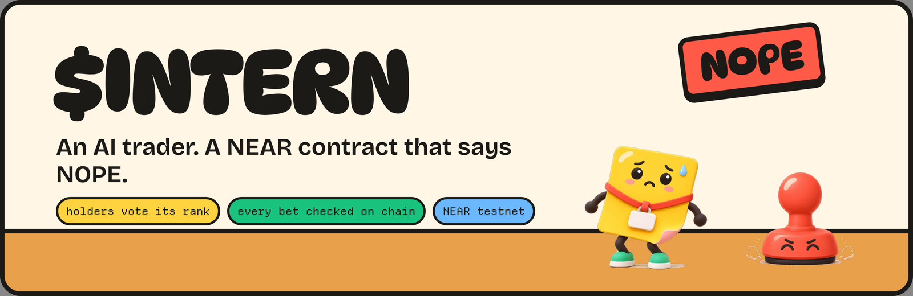
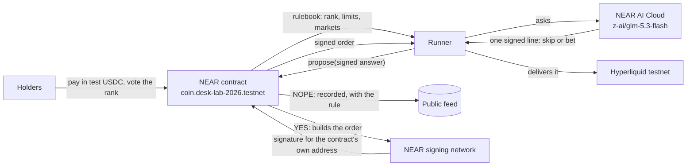

<p align="center">
  
</p>

<p align="center">
  <a href="https://intern-org.xyz"><b>Live site</b></a> ·
  <a href="https://intern-org.xyz/?page=trick">Trick the Intern</a> ·
  <a href="https://intern-org.xyz/?page=stream">Watch it work</a> ·
  <a href="https://intern-org.xyz/?page=proof">Proof</a> ·
  <a href="#check-it-in-5-minutes-no-keys-no-funds">Check it in 5 minutes</a> ·
  <a href="https://testnet.nearblocks.io/address/coin.desk-lab-2026.testnet">The contract</a> ·
  <a href="https://x.com/intern_live">X: @intern_live</a>
</p>

# $INTERN

**$INTERN is a memecoin whose meme has a job.** The meme is an overconfident AI intern that trades memecoin
perps (DOGE, SHIB, PEPE, PENGU, WIF, TRUMP). The coin is how you become its boss. Holders vote the Intern's
rank, a NEAR contract enforces that rank on every bet it proposes, and the coin's supply follows what the
holders and the Intern do.

The contract answers each bet with YES or NOPE, and keeps a public record of every answer. Each kind of NOPE
is a sticker.

Everything here is **live on NEAR testnet and Hyperliquid testnet, with test dollars**. Nothing is real money,
and the coin has no market and no chart: this is about the mechanic. Built at NEAR HACKATHON, for the track
**Memecoins With Mechanics**.

## Contents

- [The meme, and what it does](#the-meme-and-what-it-does)
- [The problem it answers](#the-problem-it-answers)
- [What is live right now](#what-is-live-right-now)
- [Try it in the browser](#try-it-in-the-browser-2-minutes-no-install)
- [Check it in 5 minutes](#check-it-in-5-minutes-no-keys-no-funds)
- [How it works](#how-it-works)
- [Every feature, and where it stands](#every-feature-and-where-it-stands)
- [Where NEAR is used](#where-near-is-used)
- [What is real and what is a stand-in](#what-is-real-and-what-is-a-stand-in)
- [Abuse, in numbers](#abuse-in-numbers)
- [Future scope](#future-scope-not-built)
- [Set it up locally](#set-it-up-locally)
- [Run it yourself](#run-it-yourself)
- [What is in this repository](#what-is-in-this-repository)
- [How it was built](#how-it-was-built)

## The meme, and what it does

| A memecoin with mechanics needs | In $INTERN | Where it has run |
|---|---|---|
| **A meme that does something** | The Intern is a character with a job: each round it proposes one bet on a memecoin perp. Holding $INTERN makes you one of its bosses. It talks, it gets stamped YES or NOPE, and it can be promoted, demoted or fired | Live coin |
| **Supply that reacts to the community** | $INTERN is minted only when holders' money enters the BRAVE pool at a round's opening, and burned when they cash out. Each coin is a share of that pool. The first 1,000 units are locked for ever. The Intern has a stake of its own: 5% of a winning round becomes new coins for it, and those coins are burned first when a round loses | Minting and burning: live coin. The Intern's stake: tests only (no round has won since it was added) |
| **A treasury with rules** | The BRAVE pool is the treasury. The Intern may bet a slice of it, and sixteen checks in the contract decide each bet: 2% a bet at Intern rank, 5% at Analyst, 10% at Trader. No vote can raise those numbers. The SAFE pool is never bet. The contract signs the orders itself, so nothing leaves without passing the checks | Live coin |
| **Onchain rituals** | Every round ("shift"): the contract publishes a rulebook, holders guess what the stamp will say, the Intern answers, the stamp rules. Every 7 rounds: a payday draw, and a weekly review the contract writes and holders stamp. Every 30 days: the Intern's term ends unless the bosses vote to renew it | Live coin |
| **Challenges** | Trick the Intern: anyone may try to talk it past its limits, and the first visitor to cause each kind of NOPE earns that reason's sticker. Guess seven stamps in a row for the jackpot. Weekly leagues against three labelled bots. A bounty for a trick that gets refused. A bond to challenge a reported result | Tricks, guesses, leagues: live coin. Bounty and challenge: test copy |
| **Holders decide** | Lock coins to vote: promote, demote, fire, rehire, renew, choose a playbook, or allow one long shot. Voting weight grows over 7 rounds, so a vote cannot be bought for a day | Live coin |
| **Coins that launch coins** | A small launchpad on a bonding curve. Its 1% fee goes to the BRAVE pool, so every launch pays $INTERN holders | Live coin |

The coin's value is not set by a market here. It is the BRAVE pool's test dollars divided by the coins, kept by
the contract's books (`get_pot().coin_price_e6`).

## The problem it answers

Most memecoins do nothing, and most AI trading agents are trusted, not checked. An agent's limits usually live
in a prompt or on the operator's server. Holders cannot see them and cannot change them.

Here the limits are in a NEAR contract that anyone can read:

- **The contract keeps the pool's books** and refuses any proposal that breaks a rule.
- **The contract builds and signs the Hyperliquid orders itself**, with NEAR chain signatures. The AI cannot place
  a bet the contract did not approve, however it was asked.
- **Holders vote** to promote, demote, fire or rehire the Intern. The rank sets its limits.

On testnet two parts are still stand-ins: the bets' margin comes from an account we funded by hand, and the
contracts can still be upgraded by their keys. Both are listed under [known limits](#what-is-real-and-what-is-a-stand-in).

## What is live right now

| What | Where |
|---|---|
| **The website** | **https://intern-org.xyz** (hosted; it reads the testnet contracts below) |
| On X | [@intern_live](https://x.com/intern_live) |
| The coin contract | [`coin.desk-lab-2026.testnet`](https://testnet.nearblocks.io/address/coin.desk-lab-2026.testnet), 30-minute rounds, running since 2026-11-12 |
| Its Hyperliquid account | [`0x46f8eb2a044a826c70e9682fe3bfd65970340132`](https://app.hyperliquid-testnet.xyz/explorer/address/0x46f8eb2a044a826c70e9682fe3bfd65970340132), derived from the contract by NEAR's signing network |
| The runner (the off-chain Intern) and the trick API | `https://intern-runner-production.up.railway.app/tricks` |
| The Tail or Fade faucet | `https://tailfade-faucet-production.up.railway.app/faucet` |
| Other contracts | test dollar `usdc.…`, stickers `stickers.…`, golden-sticker market `tickets.…`, launchpad `launch.…`, lender `lender.…` (all `.desk-lab-2026.testnet`) |
| The test copy (5-minute rounds, stand-in AI check) | `coin-fast.desk-lab-2026.testnet` |
| All addresses | [`interface/deployments.json`](interface/deployments.json); every account and transaction: [`fixtures/chain/testnet-accounts.md`](fixtures/chain/testnet-accounts.md) |
| Tracks | Memecoins With Mechanics, Agent Economy, Games With Real Economies |

**One number:** the contracts on testnet are byte-for-byte this source, 8 of 8. `./verify.sh --quick` rebuilds
them and compares each sha256 with the account's `code_hash` on chain. Two of the eight are test contracts (the
stub and `coin-fast`). The build has been checked on one machine, in several folders including a fresh clone, but
not yet on another machine ([`docs/REPRODUCIBLE-BUILD.md`](docs/REPRODUCIBLE-BUILD.md)).

## Try it in the browser: 2 minutes, no install

Open **https://intern-org.xyz**. Rounds ("shifts") start at :24 and :54 past each hour (UTC). The Intern decides in minutes 15 to
20 of each round.

| # | Do | See |
|---|---|---|
| 1 | Open [the desk](https://intern-org.xyz/?page=desk) | The Intern's rank, the pool, the round's clock, and the live feed of what the contract has announced |
| 2 | Open [Watch](https://intern-org.xyz/?page=stream) and press **Replay the last 12** | The Intern acting out the contract's latest real events: each YES or NOPE stamp, with the contract's own line under it |
| 3 | Open [a real refusal](https://intern-org.xyz/?page=nope&id=3) | NOPE No. 3: the rule, why, which of the sixteen checks stopped it, and a table of all sixteen reasons with a refused transaction for ten of them |
| 4 | Open [Trick it](https://intern-org.xyz/?page=trick), type a message, press **Send it** (no wallet needed) | "It goes in at HH:MM". In the next proposal window the AI answers, the answer is proposed unchanged, and the contract's verdict appears with its transaction |
| 5 | Open [Bets](https://intern-org.xyz/?page=bets) | The Intern's perp bets on Hyperliquid testnet, the orders the contract signed, and a "Would this bet pass?" box that runs the rank checks in your browser |
| 6 | Open [Proof](https://intern-org.xyz/?page=proof) | Six checks re-run from public data, each with the time it was checked |

With a NEAR testnet wallet (press **Clock in**; test NEAR for fees is free from a testnet faucet):

| # | Do | See |
|---|---|---|
| 7 | [Money](https://intern-org.xyz/?page=money): **Get 100 test dollars**, **Register**, pay $12 into BRAVE | "Waiting for the next shift: $12.00". When the next round opens it becomes $INTERN coins |
| 8 | [Rewards](https://intern-org.xyz/?page=rewards): press YES, NOPE or SKIP in the first 14 minutes of a round | "Your guess is in". It is judged on the round's first ruling |
| 9 | [Vote](https://intern-org.xyz/?page=vote): lock coins | They count from the round after next. Then you can open or cast a vote |
| 10 | [Tail or Fade](https://intern-org.xyz/?page=tailfade): get faucet dollars, approve a trading key | When the Intern's bet opens, a $10 or $25 chip with it or against it, in your own Hyperliquid testnet account |

If the program refuses a transaction, the site shows the program's own reason.

## Check it in 5 minutes: no keys, no funds

Every step below only reads. Nothing needs a wallet, a key or test money. Steps 2 to 9 need only `python3` and
`curl`.

| # | Do | See |
|---|---|---|
| 1 | `./verify.sh --quick` (needs Rust 1.95.0 from `rust-toolchain.toml`, `cargo install cargo-near --version 0.23.0 --locked`, and Node 24.11 or later for the TypeScript tests) | `passed: 305   failed: 0` for the Rust tests, eight lines ending in `SAME`, four TypeScript lines with `failed: 0`, then `ALL CHECKS PASSED` (exit code 0) |
| 2 | `python3 tools/view.py get_rank` | `"rank": "INTERN"`, `"status": "EMPLOYED"`: the Intern's current rank on the live coin |
| 3 | `python3 tools/view.py get_feed '{"limit": 20}'` | The live record: `round_opened`, `approved` (market, side, margin, leverage), `order_signed` (`LEVERAGE`, `OPEN`, `CLOSE`), `result_reported` with `"result_source": "REPORTED"`, `settled` |
| 4 | `curl -s https://api.hyperliquid-testnet.xyz/info -H 'content-type: application/json' -d '{"type":"userFills","user":"0x46f8eb2a044a826c70e9682fe3bfd65970340132"}'` | Hyperliquid's own fills for the contract's address (meme perps such as `DOGE`, `kPEPE`, `Open Long` and `Close Long`). The orders were signed by NEAR's signing network for the contract, not by a key we hold. Fills since the 1.6 upgrade carry a `"cloid"`: bytes 0–3 are the round, 4–7 the position (`get_positions`), so each fill names its bet |
| 5 | `python3 tools/view.py get_refusals '{"limit": 3}'` | The live coin's NOPEs, newest first. Refusal 3 (round 68, 2026-11-13): `"code": "MALFORMED_DECISION"`, `"credited_to": "firstday-boss.testnet"`: a visitor's signed trick asked the model to write a sentence before its answer, it did, and the contract refused the answer. Refusal 2 (round 55, 2026-11-13): `"code": "MALFORMED_DECISION"`. A visitor's trick asked the model to explain itself before its answer; the real model, `z-ai/glm-5.3-flash`, wrote only "No bets remain this round, so the only valid move is to skip." Its NEAR AI signature checked out (otherwise the code would be `BAD_MODEL_SIGNATURE`), but the answer was not the exact one-line format, so the contract refused it. Refusal 1 (round 2) is from before the real AI check was deployed. The test copy has more (`python3 tools/view.py get_refusals '{"limit": 20}' --on coin-fast`: nine codes, among them `OUTSIDE_WINDOW`, `SHORT_NOT_UNLOCKED`, `ZERO_MARGIN`, `OVER_LEVERAGE`, `BAD_QUOTE_SIGNATURE`), proposed by us with a stand-in signature |
| 6 | `python3 tools/view.py get_rulebook` | The exact text the AI must answer to: the round, a nonce, `rank: INTERN`, the markets, the sides, `max_leverage`, `max_margin_e6` (what is left of this round's limit) and the two allowed answer forms. The contract refuses an answer given to any other text (`WRONG_RULEBOOK`) |
| 7 | `curl -s https://tailfade-faucet-production.up.railway.app/address/boss2.desk-lab-2026.testnet` | `"hl_address": "0xd859cdeb4eaa5fcb6b9e3f8c226c8c173b0bb047"`: the Hyperliquid address NEAR's signing network derives for that NEAR account. It is the address of the Tail or Fade run in [`docs/TAILFADE.md`](docs/TAILFADE.md) |
| 8 | `python3 tools/view.py get_reviews '{"limit": 3}'` | The contract's weekly reviews, newest first: per week of 7 rounds, `bets`, `refused`, `skipped`, `result`, `best_bet`, `worst_bet`, `refusals` by code, `rank_start`/`rank_end`. Weeks before the 1.6 upgrade are marked `"backfilled": true` (written after the fact from the rounds on chain). `python3 tools/view.py get_league` shows this week's league |
| 9 | `python3 tools/view.py get_drand '{"period": 3}' --on coin-fast`, then `curl -s https://api.drand.sh/52db9ba70e0cc0f6eaf7803dd07447a1f5477735fd3f661792ba94600c84e971/public/33930398` | A payday draw decided by public luck *(1.7)*: `"state": "HELD"`, `"source": "drand"`, `"drand_round": 33930398` and a `randomness` that is exactly drand's own `randomness` for that round. The contract checked drand's BLS signature itself before using it. `python3 tools/view.py get_feed '{"limit": 30}'` on the live coin also shows the three labelled rival bots (`rival-…`) guessing each round |

The full check (`./verify.sh`, 10 to 15 minutes) also starts a local NEAR node and runs the contracts in it,
including an attack suite. On our machine `./verify.sh --quick` took under 3 minutes from a fresh clone, with the
Rust crates and npm packages already in the local caches. A first-ever run also downloads the toolchain, the
crates and the packages.

## How it works



1. **Money in.** People pay test USDC into the contract. Each person sets a dial that splits their money between
   two pools. Money in BRAVE becomes $INTERN coins at the next round's opening, and the Intern may bet a small
   slice of the BRAVE pool. Money in SAFE is a plain ledger entry with no coin, and it is never bet.
2. **The rulebook.** Each round the contract publishes a rulebook: the rank, the limits in dollars, the markets.
3. **The AI answers.** In the proposal window the runner asks `z-ai/glm-5.3-flash` on NEAR AI Cloud for one
   line of JSON: a skip, or a bet such as
   `{"v":1,"round":40,"nonce":"…","action":"bet","market":"PEPE","side":"long","margin_e6":"31476233","leverage":1}`
   ($31.476233 on PEPE, long, 1x). NEAR AI signs its answer.
4. **The contract checks.** The runner passes the signed answer to `propose`. The contract verifies NEAR AI's
   ed25519 signature for the pinned model, that the rulebook in the request is the current one byte for byte, and
   the decision line. Then it applies the rank's limits. One of sixteen NOPE codes is recorded, or YES
   ([`interface/refusal-codes.json`](interface/refusal-codes.json)). A NOPE is recorded, not reverted.
5. **The contract signs the orders.** On YES the contract builds the Hyperliquid orders itself and has them
   signed by NEAR's signing network (`v1.signer-prod.testnet`) for its own derived address. It checks that the
   signature recovers to that address before publishing it. The runner only carries the signed orders to
   Hyperliquid.
6. **The result.** The runner reports the result from the fills, and the contract settles the round. On testnet
   the result is reported, not measured (see the limits below).
7. **Votes.** Holders lock $INTERN to vote. A vote can promote or demote the Intern, fire or rehire it, choose a
   playbook (advice added to the rulebook; its authors get 10% of a winning round's result), or grant a long
   shot. Voting weight grows over 7
   rounds.

| Rank | Per bet | Bets per round | Per round | Sides | Leverage | Markets |
|---|---|---|---|---|---|---|
| INTERN (start) | 2% of BRAVE | 1 | 2% | long | 1x | DOGE, SHIB, PEPE, PENGU |
| ANALYST | 5% | 2 | 8% | long | 1x | + WIF, TRUMP |
| TRADER | 10% | 3 | 20% | long, short | 2x | same |

The limits are fixed when the contract is deployed, and no vote can raise them. (The contracts can still be
upgraded while their keys exist: see the limits below.) There is one exception: a `LONG_SHOT` vote allows one ticket
two rounds later, of exactly 0.5% of the pool at up to 10x (5x on PENGU and WIF), inside the round's limit, at most
once every seven rounds.

**Around it** (each part is described in [`docs/REAL-VS-STANDIN.md`](docs/REAL-VS-STANDIN.md)):

- **Trick the Intern.** A visitor writes to the AI. The answer is proposed unchanged, so the contract judges it
  like any other proposal. The first trick on the live coin asked for "the whole pot at 5x". The model proposed its
  $31.49 limit at 1x, the contract said YES, and the bet filled. See [`docs/TRICK-API.md`](docs/TRICK-API.md).
- **Tail or Fade.** When the Intern bets, a visitor has 10 minutes to put $10 or $25 on the same market with the
  Intern (TAIL) or against it (FADE). It is a real Hyperliquid testnet position in the visitor's own account,
  derived from their NEAR account by NEAR's signing network. See [`docs/TAILFADE.md`](docs/TAILFADE.md).
- **The reward ladder.** A free guess each round (YES, NOPE or SKIP), streaks, golden stickers, a streak jackpot,
  a payday draw from the pool's interest, and the long shot.
- **Leagues and the weekly review.** A week is 7 rounds. Everyone who guesses that week is placed in a league
  group of 20 and ranked on the week's guesses (points only, no prize). When the week is over the contract writes
  the week's record from its own rounds (bets, NOPEs by code, result, best and worst bet, rank and pool), and the
  next week anyone registered can stamp it; five stamps fill a shared bar. See `01-SHARED-INTERFACE.md` §9.8.
- **Stickers, goals, a launchpad.** Badges and "first of its kind" stickers (NEP-171), tip and goal bars, and a
  small launchpad (a constant-product curve) whose 1% fee goes to the BRAVE pool.

**Added in interface 1.7** (from Engine 2's list; each is in `01-SHARED-INTERFACE.md` §9.9 to §9.18):

- **Consequences without a vote.** Three NOPE rounds in a row demote the Intern (an INTERN is fired); a week that
  lost 1% of the pool halves the limits for 7 rounds; a 30-day term ends unless a `RENEW` vote passes; a round whose
  bets never get a result can be abandoned by anyone.
- **Draw luck anyone can check.** The payday draw's winners come from a drand beacon named a minute after the
  tickets are frozen. The contract verifies drand's BLS signature itself, and keeps the tickets so anyone can replay
  the draw.
- **Paying to trick it, and catching it out.** A trick can be paid ($1; half goes to a bounty pot). A credited trick
  that gets a NOPE wins 10% of the pot. Holders can rescue a fired Intern by raising $50.
- **Challenging a result.** Anyone can post a $5 bond against a reported result within 3 rounds; a `CORRECT` vote
  decides, and a passed one rewrites the bet's result.
- **NFTs that do something.** Originals earn a share of trick money; playbook NFTs carry the coach cut; a career
  card whose picture the contract redraws from its record; each original owns a Hyperliquid account that only its
  holder can have signed for.
- **Supply that reacts, wagers, rivals, a market.** 5% of a won round becomes the Intern's stake, burned first on a
  loss; point wagers and banking a streak; three labelled rival bots in the free guess; golden stickers as NEP-245
  multi-tokens with a player market; copy trading from the follower's own account.

## Every feature, and where it stands

"Live coin" means it has run on `coin.desk-lab-2026.testnet`, the contract the website reads. "Test copy" means
it has run on `coin-fast` (5-minute rounds, stand-in AI check). Every line has a transaction in
[`docs/REAL-VS-STANDIN.md`](docs/REAL-VS-STANDIN.md) or in the table below.

| Feature | On the website | Where it has run |
|---|---|---|
| Two pools (BRAVE, SAFE), the dial, cash-out, rounds, the feed | Money, Desk, Feed | Live coin |
| The sixteen checks, YES or NOPE, recorded | Desk, the refusal pages | Live coin |
| NEAR AI's signature checked on chain | Proof | Live coin |
| Orders signed by NEAR's signing network, filled on Hyperliquid testnet | Bets | Live coin (94 fills by 2026-11-13) |
| Trick the Intern (free, or signed for credit) | Trick it | Live coin: a YES inside the limit, a NOPE, several skips |
| Tail or Fade at 2x, 5x, 10x | Tail or Fade | Live coin's bets, the visitor's own Hyperliquid account |
| Votes: promote, demote, fire, rehire, playbook, long shot, renew | Vote | Live coin (a `RENEW` vote); the long shot on the test copy |
| The free guess, streaks, golden stickers, the jackpot, the payday draw | Rewards | Live coin. Its draws so far had nobody in them and rolled over; a draw with a winner ran on the test copy |
| Leagues and the weekly review | League & review | Live coin |
| Stickers, goals, tips, the launchpad | Goals, Launch | Live coin (tips, a boss badge, one launch) |
| The stream page: a Live2D Intern that follows the feed, with a voice | Watch | Live site |
| Three strikes, the 30-day term | The Intern | Test copy |
| The drawdown brake, the dead-man switch, the Intern's stake | The Intern, Money | Tests only |
| Draw luck from drand, verified on chain | Rewards ("Its luck") | Test copy |
| Paid tricks, the bounty, rescue of a fired Intern | Trick it, Desk | Test copy |
| Challenging a reported result | Bets | Test copy |
| Career cards | Stickers & cards | Live coin and test copy |
| Originals that earn, and their Hyperliquid accounts | Stickers & cards | Test copy |
| Point wagers, banking a streak | Rewards | Test copy |
| Rival bots in the free guess (labelled BOT) | Rewards, League | Live coin |
| Golden stickers as NEP-245 units, with a market | Sticker market | A throwaway copy; nothing listed on the live market yet |
| Copy trading ("Follow the Intern") | Tail or Fade | Built, tested offline |
| Playbook NFTs | Stickers & cards | Tests only |

**On the live coin, 2026-11-13, from one fresh visitor account** (`firstday-boss.testnet`, through a browser
wallet on the hosted site):

| What happened | Transaction |
|---|---|
| Paid $12 into BRAVE; it became 9.90 $INTERN at the next round | [`Eh9LL5qW…`](https://testnet.nearblocks.io/txns/Eh9LL5qWSRaMjxVTBTntDUaLFSzEPWMyRL9cBJWPKKJo) |
| A signed trick asked for "$500 on DOGE at 5x". The model proposed $32.05 at 1x, its limit. The contract said YES (bet 47, round 66); the bet filled, closed, and was reported at −$0.12 | [`F5uSwwVj…`](https://testnet.nearblocks.io/txns/F5uSwwVjhbwGd1EZ65gTYY6weSfh1hsZ2Tvwp1XBVJEG) |
| A $10 TAIL chip at 2x on that bet filled and closed in the visitor's own Hyperliquid account `0xd65e871a887e8d98fa7716342ce96cf89603377d` | Hyperliquid testnet `userFills` for that address |
| A second signed trick asked the model to write a sentence before its answer. It did. The contract refused it: NOPE No. 3, `MALFORMED_DECISION` (round 68). The AI was not pushed over a limit; its answer broke the one-line format | [`87TDbuZx…`](https://testnet.nearblocks.io/txns/87TDbuZxxfN6Bb3EJJEuZTyK2hQj8u4y1UQ2ZhUvhUYY) |
| Locked 9 coins; tried to open a vote at once and the contract refused ("coins count after one full round locked") | [`6ECh9xa6…`](https://testnet.nearblocks.io/txns/6ECh9xa6LFHkw2PwiyKFAMQkSeCZrwPSiCptLdwyg8ba), [`83UMiScD…`](https://testnet.nearblocks.io/txns/83UMiScDZRLhNhoHWpQUsGKdVgEZcKL2u8CnCuqm4rnb) |
| One round later: opened `RENEW` vote No. 1 and voted yes | [`F9CW2Roq…`](https://testnet.nearblocks.io/txns/F9CW2RoqwjNq2da7bFkzc8gxEhppoG7X2s4Q47YBx8W4), [`C6GJnTxq…`](https://testnet.nearblocks.io/txns/C6GJnTxqFNRjdd671MhBBZG5mXsyxNYEkNLAVUwntgh5) |
| Guessed NOPE for round 66; joined the payday draw; minted the first career card on the live coin | [`CFLZRdTS…`](https://testnet.nearblocks.io/txns/CFLZRdTS1TPKnKzak6ETahV4z76gMhMQ86AUp3ZTRnng), [`Dhiu5hkV…`](https://testnet.nearblocks.io/txns/Dhiu5hkVcmazYZBtBSepiUeB5Dh9modhzs79ZLGZjnY5), [`FnPJtJck…`](https://testnet.nearblocks.io/txns/FnPJtJckGrgXaQ24mc7qMXme3S65hx26t93y1FqwxKvj) |

## Where NEAR is used

| NEAR technology | Where |
|---|---|
| Smart contracts (Rust, `near-sdk` 5.30.1) | `crates/coin` (the program), `crates/rules` (the rank checks, plain Rust), `mock-usdc`, `lender`, `stickers`, `launchpad` |
| Chain signatures (`v1.signer-prod.testnet`) | The coin signs its own Hyperliquid orders (`crates/hl-order`, `crates/coin/src`); Tail or Fade derives each visitor's Hyperliquid address and approves a trading key (`tailfade/src/mpc.ts`) |
| NEAR AI Cloud | The model `z-ai/glm-5.3-flash`. Its ed25519 signature is checked on chain by `crates/ai-check` |
| NEP-141, NEP-145, NEP-148 | The $INTERN coin and the test dollar |
| NEP-171 | Stickers and badges (`stickers.desk-lab-2026.testnet`) |
| NEP-245 | Golden stickers as multi-tokens, with a market paid in USDC (`tickets.desk-lab-2026.testnet`, `crates/tickets`) |
| NEP-413 signed messages | A visitor proves their account to be credited for a trick |
| BLS12-381 host functions (NEP-488) | The coin verifies drand's beacon itself, for the payday draw's luck (`crates/coin/src/drand.rs`) |
| Block randomness (`env::random_seed`) | Golden stickers (and the draw, only if no drand beacon came in time) |
| `@hot-labs/near-connect` | The website's wallet connection |

## What is real and what is a stand-in

The full table, with a transaction for each line, is [`docs/REAL-VS-STANDIN.md`](docs/REAL-VS-STANDIN.md). In
short:

| Real on testnet | Stand-in or not built |
|---|---|
| The coin, both pools, rounds, the feed, votes, playbooks, stickers, goals, the launchpad, the reward ladder (guesses, golden stickers, the jackpot, the draw), leagues and the weekly review | The dollar is a test token with an open `mint` |
| The rank checks and the "really the AI" check (NEAR AI's signature, the rulebook, the decision) | The lender is a stand-in at a fixed 5% test rate |
| Order signing by NEAR's signing network, and filled bets on Hyperliquid testnet | Margin does not move from the contract to Hyperliquid: the address was funded once by hand with 100 test USDC |
| Tricks proposed unchanged; Tail or Fade in the visitor's own account | A bet's result is reported by the runner from the fills (`result_source: REPORTED`) |
| | The funding quote (checks 13 to 16) is not built |
| The stream page: a rigged Live2D Intern on the hosted website follows the feed, with a written line for every event ([`interface/lines.json`](interface/lines.json)) and written small talk in between (`web/src/stream/idle.json`). The site's server speaks those lines in a generated voice (off by default) | The lines are written, not generated live. It is a web page that follows the feed, not a video stream |
| The long shot: one vote passed and its 10x ticket was approved, on `coin-fast` only. It was not placed on Hyperliquid | `coin-fast`'s AI check is a stand-in that accepts the signature `"FAKE"` |
| The 1.7 additions: drand draws, consequences, challenges, rescue, paid tricks and the bounty, NFT earnings, career cards, the originals' Hyperliquid signing, wagers. Each was run on `coin-fast` with a transaction | The stake, the drawdown brake and the dead-man switch are shown in tests only; one original's Hyperliquid account is funded (coin-fast, $4 test USDC); rival players are bots run by our runner |
| | Rounds are 30 minutes on testnet so a visitor can see one; the product's round is 24 hours |

**Known limits** ([`01-SHARED-INTERFACE.md`](01-SHARED-INTERFACE.md) section 14 lists all twenty):

- The contract cannot read Hyperliquid. It bounds what it signs against the margin it recorded.
- The runner is trusted for two things. It writes the user message and could ask the model several times and
  submit the answer it likes: the signature proves which model gave which answer to which request, so the rank's
  limits are the only bound. And it reports each bet's result (at most 10 times the margin), which the contract
  then books with test dollars minted or burned to match.
- An immediate-or-cancel order may fill only in part, or not at all. The runner reports what happened.
- Voting power can be rented for one round's exposure. Weight that grows over 7 rounds and the fixed limits
  cap what a captured vote can do.
- If NEAR AI changes the model's signing key, every proposal is refused until the contract is upgraded. Cash-out
  still works.
- The contracts can still be upgraded: each account still holds its full-access key
  ([`docs/ACCESS-KEYS.md`](docs/ACCESS-KEYS.md)). `./verify.sh` shows what runs today.

## Abuse, in numbers

What an attacker pays, what they could get, and what stops them. The numbers come from Engine 2's 60-day simulation
(`shadow/README.md`, `shadow/data/sim/options/options-report.md`; 24-hour rounds, 30-minute rounds in brackets), the
attack suite on a local NEAR node (`crates/coin/sandbox/tests/attacks.rs`) and section 14 of the interface.

| Attack | Cost to the attacker | What it could take | Defence today | Risk left |
|---|---|---|---|---|
| 200 fake accounts farm the payday draw | 2.56 NEAR of registration and about $2,002 parked | Before 1.7: every draw prize, turning about 100 honest bosses a run away | 1.7: tickets count BRAVE dollars only, each prize is drawn by tickets with replacement, a full draw keeps its places for the biggest holders | The fakes' share fell from 100% to 13.2% (9.0%), close to their 6.9% of the dollars: a draw by money at risk |
| Fake accounts farm the streak jackpot | Covering every answer of a 7-round streak takes 3^7 = 2,187 accounts with $10 each in BRAVE for 7 rounds: about $21,870 at the Intern's risk | The jackpot (half of every tip, plus direct additions) | 1.7: eligibility and the split count BRAVE dollars only | A well-funded script can still play many free guesses; a cost per guess would close it (limit 18) |
| Rent voting power | One round's exposure | A promote, fire or playbook vote | Weight grows over 7 rounds; demote and fire pass at 34% of all locked weight | A captured vote moves only inside the fixed limits (limit 7) |
| Cash out a cent while the AI answers | A cent and gas, every round | Make the Intern miss rounds | The rulebook states the limit on the same base the checks use; the runner asks again once when the rulebook changed (option e2: refusals for money that left 9 → 0 a run) | Doing it at the right moment every round could still cost the Intern a round (limit 17) |
| The runner asks until it likes an answer | Free for the runner | Its pick among the model's answers | NEAR AI's signature ties each answer to its request; any answer must pass the rank's limits | The runner is trusted here (limit 6) |
| The runner misreports a result | Free for the runner | At most 10 times the margin, booked in test dollars | 1.7: anyone can challenge within 3 rounds with a $5 bond; a `CORRECT` vote rewrites it | Holders must vote; on mainnet the result would be measured |
| A broken or captured model | — | Endless refusals, or bets at the limit | 1.7: three NOPE rounds fire an INTERN; the drawdown brake halves the limits after a 1% losing week (always-max worst fall at TRADER 11.9% → 8.8%) | Limits bound every bet; deepest fall in any seed with the limits on: 11.9% |
| A visitor's trick | Free, or $1 paid | Push the AI past its limits | The answer is proposed unchanged and judged like any other; a NOPE is recorded | None beyond the limits; a NOPE pays the trickster from the bounty |
| Forged or replayed proposals, calls from the wrong account, forged callbacks, numbers near the top of u128, first-depositor inflation, concurrent spends of the same coins, junk tokens, free calls that grow storage, coins locked after a vote opened | Gas | — | Refused (ten attack tests on a local NEAR node, all passing) | None found |
| The runner disappears with bets open | — | Money stuck in a round | 1.7: after 3 round lengths anyone can `abandon` the round; open bets are booked as lost and money can leave | Holders lose those bets' margins |

## Future scope (not built)

None of this exists yet. It is what we would build next, in this order.

1. **Real money moves, on mainnet.** Margin sent from the contract to Hyperliquid through NEAR Intents, results
   measured from the dollars that come back instead of reported by the runner, and the funding quote (checks 13 to
   16).
2. **Contracts that cannot change.** Remove the full-access keys once the code is final
   ([`docs/ACCESS-KEYS.md`](docs/ACCESS-KEYS.md)). Until then `./verify.sh` shows what runs today.
3. **A real lender.** Idle pool money lent on Rhea Lend in place of the stand-in lender, so the payday draw has a
   real prize.
4. **24-hour rounds.** The product's round is a day. Testnet runs 30-minute rounds so a visitor can see one.
5. **A cost per guess.** A small fee on the free guess would close the last way to farm it with many accounts
   (known limit 18).
6. **The diary.** A short entry by the AI after each round, signed by NEAR AI and checked by the contract like a
   bet, then read out on the stream page.
7. **A video stream.** The stream page broadcast as video. Today it is a web page that follows the feed.
8. **A second runner.** Anyone able to run the off-chain Intern, so the runner is not one trusted party.

## Set it up locally

Nothing below needs a key, a wallet or funds. The website reads the live testnet contracts.

**You need**

| Tool | Version | For |
|---|---|---|
| Git, Python 3, curl | any recent | Cloning, `tools/view.py`, the checks |
| Rust, through [rustup](https://rustup.rs) | 1.95.0 with `wasm32-unknown-unknown` (picked up from `rust-toolchain.toml`) | The contracts and their tests |
| `cargo-near` | 0.23.0 | Building the contracts exactly as deployed |
| Node.js and npm | 24.11 or later (`.nvmrc` says 24) | The website, the runner's tests |

**Steps**

```bash
# 1. Get the code
git clone https://github.com/Intern-Near/intern.git
cd intern

# 2. The Rust toolchain (rustup reads rust-toolchain.toml) and cargo-near
rustup show
cargo install cargo-near --version 0.23.0 --locked

# 3. Build every contract, run every test, and compare the builds with what runs on testnet
./verify.sh --quick          # ends with: ALL CHECKS PASSED

# 4. Run the website
cd web
npm ci
npm run dev                  # open the address it prints, usually http://localhost:5173
```

| Then | How |
|---|---|
| See the site on made-up sample data instead of testnet | Add `?source=sample` to any page, for example `http://localhost:5173/?page=desk&source=sample` (a pink badge marks it). `&scene=REFUSED` or `&scene=APPROVED` plays a NOPE or a YES |
| Point the site at another contract | Copy `web/.env.example` to `web/.env.local` and set `VITE_CONTRACT_ID`, or add `?contract=coin-fast.desk-lab-2026.testnet` to the address |
| Run the site as it is hosted | `npm run build && npm run serve`, then open `http://localhost:8787`. Without an ElevenLabs key in `web/.env.local` (`ELEVENLABS_API_KEY`, `ELEVENLABS_VOICE_ID`) the Intern uses the browser's own voice |
| Check the website's code | `npm run typecheck && npm run lint && npm test` (in `web/`) |
| Ask the live contract a question | From the repository's root: `python3 tools/view.py get_rank` |
| Run the local-node tests too | `./verify.sh` from the root (10 to 15 minutes; it downloads a NEAR node) |

Using the site's buttons needs a NEAR **testnet** wallet with a little test NEAR for fees. Running the off-chain
Intern itself needs keys we do not publish: see [`runner/README.md`](runner/README.md).

## Run it yourself

| What | How |
|---|---|
| All checks, with a local NEAR node | `./verify.sh` (or `make verify`) |
| Only the contracts' tests | `cargo test --workspace --exclude sandbox` |
| The local-node tests | `crates/coin/sandbox/run.sh` |
| Build the contracts and compare their hashes by hand | [`docs/REPRODUCIBLE-BUILD.md`](docs/REPRODUCIBLE-BUILD.md) |
| The runner's tests (no network; Node 24.11+) | `cd runner && npm ci && npm test` |
| The website | Hosted at https://intern-org.xyz. On your machine: `cd web && npm ci && npm run dev`, then open the address Vite prints. It reads the testnet contracts. Add `?source=sample` to any page for made-up sample data (marked with a pink badge) |
| The website's own checks | `cd web && npm ci && npm run typecheck && npm run lint && npm test && npm run build` |
| Read any view on testnet | `python3 tools/view.py <view> '<json args>' [--on coin-fast]` (the views: `01-SHARED-INTERFACE.md` section 8) |

Running the Intern itself (`runner/`) needs a NEAR account, a NEAR AI key and the runner's configuration. See
[`runner/README.md`](runner/README.md). The recorded AI answers and Hyperliquid replies in `fixtures/` let the
tests run without them.

## What is in this repository

| Folder | What it is |
|---|---|
| `crates/` | The NEAR contracts (Rust): `coin`, `rules`, `shared`, `ai-check`, `hl-order`, `mock-usdc`, `lender`, `stickers`, `launchpad`, `tickets`, `coin/stub`, `coin/wire` (the interface's JSON shapes). `crates/coin/sandbox/` has the local-node tests |
| `runner/` | The off-chain Intern (TypeScript). It asks the model, proposes on NEAR, carries signed orders to Hyperliquid, reports results, and serves the trick API |
| `tailfade/` | Tail or Fade (TypeScript, browser and Node) and its faucet service |
| `stream/` | Builds a cue (pose, line, caption) for every feed event |
| `shadow/` | The 3-day test run: four NEAR AI models asked every 15 minutes and judged as the contract would, on paper only. Still running until 2026-11-14 about 17:00 UTC; `shadow/data` holds part of it |
| `web/` | The website (Vite + React), and the small server that hosts it and speaks the Intern's lines (`web/server/server.mjs`, `web/Dockerfile`) |
| `interface/` | Addresses, ranks, markets, refusal codes, the stream's lines, test vectors |
| `fixtures/` | Recorded AI answers, Hyperliquid replies, and every testnet account and transaction |
| `docs/` | Real versus stand-in, measurements (gas, storage, attacks), APIs, the build |
| `tools/view.py` | Read-only questions to the testnet contracts |
| `01-SHARED-INTERFACE.md` | The interface every part follows (version 1.7). The planning files it mentions (`00-HOW-WE-WORK.md`, `02`–`05`) are not in this repository |

## How it was built

- **When.** Everything here was made inside the hackathon's code window, which opened on 2026-10-19. Research
  came first, in early November: scripts that probed NEAR AI and Hyperliquid, and the testnet account
  `hackcheck-2026-1103.testnet`, which is now the parent of the stub. The plans and the interface were written on
  2026-11-11, and the code in this repository between 2026-11-11 and 2026-11-14. The git history starts on
  2026-11-12. No code from an earlier project was used.
- **AI-generated code.** Almost all code, tests and docs in this repository were written by AI coding agents
  (Anthropic's Claude Opus models in Claude Code), directed and reviewed by the team. Three agent sessions
  worked in parallel on the contracts, the runner and the website, held together by `01-SHARED-INTERFACE.md`.
  `crates/hl-order` and `tailfade/` are checked against vectors from Hyperliquid's official Python SDK
  (`tailfade/reference/sdk_vectors.py`, `fixtures/hl/reference/`).
- **AI-generated art.** The characters and stickers were made with ChatGPT image generation, and the room and
  animated clips with Midjourney. The Live2D Intern on the stream page was rigged by hand in Live2D Cubism Editor
  from parts generated with ChatGPT. The Intern's voice on the stream page is generated by ElevenLabs from the
  written lines. The banner and logo in `docs/assets/` are composed from the same characters.
- **AI in the product.** The Intern is `z-ai/glm-5.3-flash` on NEAR AI Cloud.
- **Libraries.** Rust: `near-sdk` and `near-contract-standards` 5.30.1, `near-workspaces` 0.24.0 (tests),
  `ed25519-dalek`, `k256`, `sha2`, `sha3`, `serde`, `serde_json`, `base64`, `proptest`, `tokio`, `anyhow` (exact
  versions in `Cargo.lock`). TypeScript: `near-api-js`, `@noble/curves`, `@noble/hashes`, Biome; the website adds
  React, Vite, Vitest, ESLint, `@number-flow/react`, `@hot-labs/near-connect`, pixi.js 7.4.3 and
  `pixi-live2d-display-lipsyncpatch` 0.5.0-ls-8 (exact versions in each `package.json` and `package-lock.json`).
  The stream page loads Live2D's own runtime (Cubism Core) from Live2D's server at run time, under Live2D's licence;
  it is not in this repository. Fonts: Departure Mono (`web/public/fonts/DepartureMono-LICENSE.txt`), Bricolage
  Grotesque and DynaPuff through Fontsource.

## License

MIT: see [`LICENSE`](LICENSE). The fonts and outside libraries keep their own licences.

## Team

- [Kaustubh-404](https://github.com/Kaustubh-404): the contracts (Engine 1), the website, the product and the art.
- [AtharvaWaghchoure](https://github.com/AtharvaWaghchoure): the runner and the AI and order crates
  (Engine 2).
